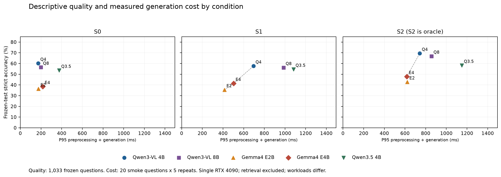
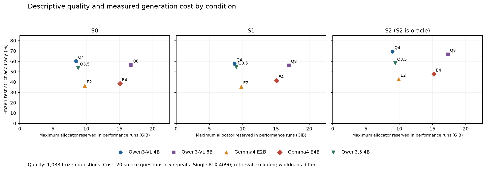

# EdgeCoRAG B 五模型证据条件比较

本报告回答：在同一批问题与同一组发布检索证据下，Gemma 4 E2B/E4B是否缩小了对Qwen视觉模型的质量差距，付出了什么生成成本。结果支持阶段性的能力边界报告，不支持“检索后小模型普遍替代大模型”的结论。

## 本次数据与协议

MRAG-Bench test共1353题，自切分为smoke20、development150、internal_holdout150、frozen_test1033。五模型都运行S0/S1/S2；Gemma另运行预冻结S3子集。S0只有查询图，S1为发布包官方候选原顺序top3，S2为实际GT常规5张/Incomplete1张。S2是oracle诊断。S1不是我们独立运行EmbeddingGemma得到的检索结果。S1与S2证据数量也不同，差值不能完全归因于证据质量。

所有模型同一RTX4090 24GB，BF16、无量化、无offload、SDPA、thinking关闭、greedy、max_new_tokens64、seed42、TF32关闭。原图与证据顺序一致；原生视觉预处理和实际视觉token并非跨模型严格等价。模型总参数数与Gemma有效参数标签不能混用。

全部161任务21927次问答完成，25份模型阶段回执exit0且完整。正式quality17807次、performance1550次、其余preflight/smoke/development分别记录；483次warmup不计入。132次格式失败严格计错，其中quality99次，performance15次，其余18次。正常格式失败不重试，技术错误仍阻断阶段。本轮没有技术错误或重试。

## 冻结集准确率

每个S0/S1/S2单元格分母1033，失败保留。internal_holdout的150题单独见CSV，不混入冻结集。

| 模型 | S0 | S1 | S2 |
| --- | --- | --- | --- |
| Qwen3-VL 4B | 60.12% | 57.60% | 69.41% |
| Qwen3-VL 8B | 56.44% | 56.15% | 66.80% |
| Gemma 4 E2B | 36.30% | 35.43% | 42.69% |
| Gemma 4 E4B | 38.43% | 41.34% | 47.73% |
| Qwen3.5 4B | 53.53% | 54.50% | 58.18% |

## 同证据下的模型差距

以下是Gemma减Qwen的准确率百分点差。所有对比使用同1033题、同S1证据。bootstrap按官方场景分层、题级配对，2000次、seed42；没有来源聚类、多重比较修正或预注册非劣效界值。这些描述性区间不能替代任务书所需的来源聚类统计。

| 共享 S1 对比 | 差值 pp | 描述性 95% 区间 |
| --- | --- | --- |
| Gemma 4 E2B − Qwen3-VL 4B | -22.17 | [-25.94, -18.59] |
| Gemma 4 E2B − Qwen3-VL 8B | -20.72 | [-24.30, -17.04] |
| Gemma 4 E4B − Qwen3-VL 4B | -16.26 | [-19.94, -12.78] |
| Gemma 4 E4B − Qwen3-VL 8B | -14.81 | [-18.49, -11.13] |

两款Gemma在本轮共享S1下都保留较大质量差距。即使GT证据可用，Gemma E2B/E4B为42.69%/47.73%，Qwen3-VL4B为69.41%。遵循Gate B1，研究叙述应转向可替代范围与失败边界。不能用Gemma S2对Qwen S0的跨条件比较宣称胜出，也未建立任何非劣效或普遍可替代子群。

五模型S2相对S1均有正向观察差值，分别为11.81、10.65、7.26、6.39、3.68pp。配对区间见 [paired_comparisons.csv](v1.10.1/paired_comparisons.csv)。S1相对S0没有一致收益。Incomplete冻结77题上S2对S0五模型都下降，保留在总体分母，不能删除，也不能凭此确定因果机制。

## 证据加入后的逐题变化

| 模型 | 错转对 | 对转错 | 对转错占全部题目 |
| --- | --- | --- | --- |
| Qwen3-VL 4B | 79 | 105 | 10.16% |
| Qwen3-VL 8B | 76 | 79 | 7.65% |
| Gemma 4 E2B | 103 | 112 | 10.84% |
| Gemma 4 E4B | 116 | 86 | 8.33% |
| Qwen3.5 4B | 110 | 100 | 9.68% |

这是S0到S1的观测转移。对转错不是已经判明由“错误证据”造成；还可能涉及视觉阅读、上下文数量和模型行为。按确定性首qid规则抽出的实例见 [failure_examples.csv](v1.10.1/failure_examples.csv)，它们尚未人工机制审定。未检索到与证据可用但未答对的完整分类需要逐题支持性/GT关系审定，不能用回答转移冒充。

按实际送入的top3与actual GT的JPEG95字节SHA比较，internal_holdout有71/150题（47.33%）、frozen_test有516/1033题（49.95%）至少命中一个GT哈希。命中与未命中分组的S0/S1/S2准确率见 [gt_overlap_strata.csv](v1.10.1/gt_overlap_strata.csv)，分场景命中率见 [gt_overlap_by_scenario.csv](v1.10.1/gt_overlap_by_scenario.csv)。例如冻结Incomplete为5/77，Others为65/92。分组只用于本次离线分析，没有参与选证据或生成。这是已提供图片的精确哈希重叠，不是独立检索R@k、语义支持性或答案泄漏证明，也不直接沿用旧文档的全1353题top5命中率55.9%。

## S3补充诊断

Gemma的frozen子集29/1033（2.81%），holdout仅2/150，development5/150。S1/S3只在完全相同的预定qid上比较，完整S1仍独立保留。frozen E2B由51.72%降至31.03%，E4B均34.48%；holdout2题不解释其退化区间。S3经AI图像辅助且label-aware审阅，预览分辨率有限、服务模型revision不可得，不是人类盲审或全基准代表性证据。

## 生成时延与显存

下表S1时延含预处理和生成，不含检索、模型加载、warmup；每组20个smoke问题乘5次共100观测。显存为同一性能工作负载记录的allocator reserved最大值，不是整卡或全系统峰值。S3只有25观测，不报P95。

| S1 模型 | P50 ms | P95 ms | 性能阶段 reserved 峰值 GiB |
| --- | --- | --- | --- |
| Qwen3-VL 4B | 285.5 | 694.8 | 8.75 |
| Qwen3-VL 8B | 387.4 | 986.4 | 16.95 |
| Gemma4 E2B | 203.8 | 413.5 | 9.77 |
| Gemma4 E4B | 264.6 | 501.6 | 15.07 |
| Qwen3.5 4B | 476.1 | 1082.1 | 9.03 |

新增质量—P95与质量—显存图按S0/S1/S2分别画图，oracle不与可部署条件混成一条前沿。图中质量取1033冻结题，成本取20smoke题乘5次，二者不是完全相同负载；虚线仅表示这批测点的描述性非支配关系。没有检索端到端、整机能耗或真实边缘设备结论。

## 证据与限制

原始输出和完整固定分母可由 [逐题压缩JSONL](../logs/B_predictions.jsonl.gz)复算；模型revision见 [注册表](../configs/model_registry.yaml)，代码与矩阵身份见 [实跑回执](../provenance/v1.10.1/execution_receipt.json)。实际执行的是父提交加v1.10.1本地补丁，由文件SHA锁定；后续发布提交不能冒称当时执行过的commit。

数据同源且有跨split图像相关性；冻结集发生已披露审计暴露；S3为小型选定子集；场景分层题级区间未处理来源依赖；没有第二数据集验证、最佳固定RAG或完整检索系统成本。完整缺口见 [Requirements.md](Requirements.md)。
