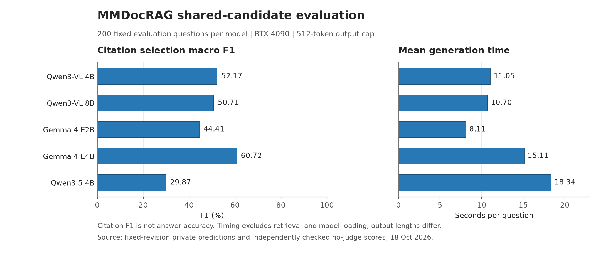

# MMDocRAG正式实验结果与论文补充

2026-10-18｜完成状态：五模型各200题，共1000次正式生成；完整备份已下载到Mac并核验。AutoDL当前实例已于约05:02提前关闭，平台确认“已关机”，早于07:00截止；实例和磁盘数据保留。实际账单尚未对账，磁盘保留可能继续产生存储费用，不把关机等同于全部费用归零。

本轮技术联调40次、开发160次、正式1000次，共1200次预测，另15次技术预热。首次技术打包导入失败为0预测，原失败回执保留；随后成功联调单独保存。未覆盖、补答或重跑正式预测。

## 可以支持的主要发现

固定200题、共享官方候选、512 token输出上限下，Gemma 4 E4B的引用选择宏F1为60.72%，高于Qwen3-VL 4B的52.17%和8B的50.71%。BLEU与ROUGE-L的最高点估计均来自Qwen3-VL 8B，因此不能把引用选择排序表述为所有回答质量指标的排序。

这与MRAG冻结选择题中Gemma E4B低于Qwen3-VL的观察构成一个值得报告的任务依赖现象。两个数据集的任务、输出预算、证据形式与指标不同，不能直接相减成“能力提升”，也不能单独确定是什么因素造成了排序变化。

## 方法：固定输入、模型身份与评价口径

固定数据revision：`04b58dbc5c6c4955291124eed411b09114728061`；作者代码revision：`2fd7505c6a576376b4a92aafaff6d87494765bb7`。五模型权重revision以冻结model_registry及每份运行回执为准。8题技术、32题开发和200题evaluation题单在观察模型成绩前固定，开发与正式题目不替换。正式200题对应123个文档名；197题有15个候选、2题14个、1题12个，原样保留。

输入是共享官方候选的文本、实际图片与问题，gold、参考答案和图片描述不进入生成器。所有模型顺序运行于同一RTX4090 24GB，采用原生视觉处理、BF16、greedy生成、固定max_new_tokens=512，无权重下载、量化或offload。共同提示和模型适配器均有SHA绑定；原生视觉处理并不等价。每题保存processor渲染后的提示、token数、输入形状与生成记录；这不等同于保存了所有运行内存状态。

正式生成前已通过1000次CPU原生处理核验。先前五模型开发生成与固定32分母评分均完成；开发中56条输出上限标记与1条空回答原样接受，未据此改参数。共同512上限与固定作者多模态入口的max_tokens=512设置一致，但本轮不构成作者完整检索、模型和judge流程的复现，也不证明512是各模型最佳预算。

主指标为发布代码兼容的逐题文本/图片引用并集F1，再对200题取宏平均。模态全局F1单独保存，不混用为论文Overall。BLEU与ROUGE-L按同一固定200分母报告，均为0–1尺度的词面辅助指标；未调用judge，未测得答案事实正确率。正常空回答与部分输出均保留，技术失败也不得从分母排除。

## 正式结果

每模型固定n=200；F1列为百分数。生成耗时为单次正式运行的平均值，不包含检索、模型加载与完整系统开销。

| 模型 | 引用宏F1（%） | BLEU（0–1） | ROUGE-L（0–1） | 平均生成秒/题 |
|---|---:|---:|---:|---:|
| Qwen3-VL 4B | 52.17 | 0.1326 | 0.2921 | 11.05 |
| Qwen3-VL 8B | 50.71 | 0.1480 | 0.3098 | 10.70 |
| Gemma 4 E2B | 44.41 | 0.0927 | 0.2645 | 8.11 |
| Gemma 4 E4B | 60.72 | 0.1453 | 0.3075 | 15.11 |
| Qwen3.5 4B | 29.87 | 0.0982 | 0.2569 | 18.34 |

Gemma E4B的平均生成耗时为15.11秒，高于Qwen3-VL 4B的11.05秒和8B的10.70秒。Gemma E2B平均8.11秒，但引用F1为44.41%。输出长度、生成架构和原生预处理均不同，不能将秒/题换算为相同答案质量下的系统替代结论。本轮未测真实边缘设备、整机功耗或完整检索端到端成本。

## 同题配对比较：探索性描述

差值为Gemma减Qwen的引用宏F1百分点。区间使用题级配对bootstrap，2000次、seed42。它是看到正式结果后的描述性分析，未做文档/图片聚类及多重比较校正，不作为预注册显著性或普遍优势证明。

| 比较 | 差值pp | 描述性95%区间pp | 胜/平/负题数 |
|---|---:|---:|---:|
| Gemma 4 E2B − Qwen3-VL 4B | -7.76 | [-13.52, -2.24] | 71/45/84 |
| Gemma 4 E2B − Qwen3-VL 8B | -6.30 | [-12.28, -0.58] | 67/44/89 |
| Gemma 4 E4B − Qwen3-VL 4B | +8.55 | [+3.85, +13.07] | 93/53/54 |
| Gemma 4 E4B − Qwen3-VL 8B | +10.01 | [+5.58, +14.32] | 96/56/48 |

Gemma E4B相对Qwen3-VL 4B在93题引用F1更高、53题相同、54题更低；平均差值+8.55pp。它并非逐题全面占优。Gemma E2B相对4B的平均差值为−7.76pp，不能将两种Gemma型号合并为同一结论。

## 错误与输出预算诊断

下表为结构性诊断。各列有重叠，不能相加作为错误总数；没有提取到引用可能是缺失引用或格式问题，不自动等同于答案事实错误。池外列为引用出现次数，不是题数。

| 模型 | 上限标记 | 空回答题数 | 无提取引用题数 | 引用F1为0题数 | 池外引用次数 |
|---|---:|---:|---:|---:|---:|
| Qwen3-VL 4B | 66/200 | 0 | 12 | 34 | 0 |
| Qwen3-VL 8B | 59/200 | 0 | 15 | 40 | 0 |
| Gemma 4 E2B | 8/200 | 7 | 8 | 54 | 2 |
| Gemma 4 E4B | 12/200 | 0 | 2 | 20 | 1 |
| Qwen3.5 4B | 116/200 | 0 | 48 | 92 | 8 |

正式共261条达到输出预算标记，定义为out_tok≥512，不能独立证明语义未完成，EOS恰在边界也可能触发。Qwen3.5的116/200条标记、48题无提取引用与29.87%引用F1同时出现，但没有预算干预实验，不能断言增加上限会改善多少。Gemma E2B的7条空回答均核实为只生成1个`<eos>`，属于保留的正常空响应，无自动重试。各模型的池外引用均按原评分规则处理，没有事后过滤来提高分数。

上述计数属于记录层面错误分解；本次另补充3道题、9张相关图片的事后定性核查，详见下文。该小组案例不构成全题语义审定或因果机制证明。

## 论文讨论与创新定位

当前支持的贡献是：共享证据和明确输出预算下的跨模型能力边界；同题配对的收益/损失与输出结构诊断；在不同任务及指标上检验模型排序的可迁移性。工程上的版本固定、门禁与完整记录使证据可核验，但本身不等于新算法。

MMDocRAG的正式引用结果补充了MRAG的准确率观察，说明仅凭单一任务或参数标签选模型不充分。这是系统评测与任务依赖的经验发现。当前没有已验证的新检索器、路由器或证据选择方法，也不能声称首次发现、最佳系统、普遍替代或论文已具备某一投稿档次；这些需要更完整的相关工作比较和方法验证。

## 局限与适用范围

1. 正式题单仅200题，是固定小规模跨数据集评测，不是MMDocRAG全量2000题或作者全流程成绩复现。
2. 训练4110条assistant答案多重集合与两套dev答案合计一致，dev仅开发；dev/evaluation存在144个文档名交集，所选图片有28个SHA跨集共享。文档名只是来源代理，不能称文档隔离，也不能据此直接认定模型训练污染。
3. 当前题级区间未处理来源相关性；固定题单及多指标比较限制外推。数据命名空间使用revision/split/setting/qid，不能跨split按裸qid连接。
4. 共享的是官方候选，不是本项目自主检索系统；没有本轮检索召回或证据选择新算法的实跑增益。
5. 引用F1、BLEU、ROUGE-L不能替代事实性、推理质量和图文连贯性评价；judge仍未运行。词面指标与引用指标的不同排序不能解释为所有能力维度的优劣。
6. 512 token预算、不同原生视觉预处理和输出长度约束了比较。未通过事后调参或补答消除空回答、输出上限与格式差异。
7. CC BY-NC与数据卡Apache许可冲突尚未获得作者澄清。按用户决定继续本地非商业研究；原始QA、图片、PDF及逐题输出保持私有，不公开再分发。
8. 旧MRAG的20条案例视觉机制审查仍未完成；这次MMDocRAG不能替代该工作。VisDoM、真实边缘设备和完整系统预算实验不在本轮完成范围内。

## 结果核验与交付边界

完整归档SHA256：`c422e6634661cbae8d7ad271f74d8b7f1d3a54e6876c436f030cd08a4f6a5043`，3400678字节。本机核验五份200题回执、预测SHA、完整题目顺序、数据与模型revision、固定源代码和配置、最终完成日志。另从引用集合交集独立重算1000个逐题F1及五个宏平均，均与评分器一致。词面评分依赖可用，分母均为200，judge状态为未评估。图表已导出PNG/SVG/PDF并检查标签与尺度。

可用汇总：[正式评测汇总](MMDocRAG正式评测汇总.csv)、[配对比较](MMDocRAG引用F1配对比较.csv)、[结构化结果](B_mmdocrag_evaluation_summary.json)。原始预测、gold与提示保存在私有work备份，不随本报告公开发布。此文是本地阶段论文补充稿，尚未提交或发表。

## 事后探索案例补充（2026-10-18）

本节在看到正式结果后选择，属于非盲、单一助手的定性探索，不是人类专家审定或新增准确率。按四个诊断层分别选择 `SHA256("edgecorag-case-v1:"+qid)` 最小题：E4B相对Qwen3-VL 4B引用收益、引用损失（比较容差1e-12）、E2B空响应、Qwen3.5预算标记。四层对应232、544、258、232，共3道不同题；候选层大小为93、54、7、116。实际查看9张相关原图，并核对候选文本、gold、正式输出和解析结果；没有穷尽全部200题。原题、完整输出和图像只保存在私有work，不在交付中复制。不能由这些案例估计总体错误率或证明因果机制。

- **引用得分高仍可概括失真（232）**：E4B引用F1为88.89%，Qwen3-VL 4B为50.00%。E4B覆盖了两张gold图片和两项gold文本，另多引一图，但它将“感到背景有优势”的代际趋势概括为递减；可见图像呈先升后降，正文数字却能正确列出。这说明引用集合覆盖不能独立担保趋势概括。Qwen4B也有总体与子群比例错配；该例不支持任一模型事实性全面占优。
- **核心答案、引用位置和解析格式可以分离（544）**：两模型核心现金流变化及主要驱动有候选证据支持，E4B引用F1却为44.44%，低于Qwen4B的61.54%。E4B指向的image2没有自由现金流行，相关数值实际可见于image1/5；同时组合数字引用`[1, 8]`不被冻结的单数字正则提取，不能把所有失分归于读图错误。案例还发现Qwen4B及gold将对账表的调整列解释为真实融资流入，故gold参考答案不能作为独立事实审定。这里只标出证据冲突，不修改gold、解析器或成绩。
- **输入有证据仍可能正常结束为空（258）**：已查看的图表具有相关增长率与用户量信息；E2B却只生成1个`<eos>`，运行状态正常结束、无回答。该事实不能判定是模板、解码、视觉理解还是其他因素造成，需未来受控实验。
- **预算标记与具体未完成输出的区分（232）**：Qwen3.5实际生成512 token，末尾图像Markdown说明文字未闭合、无可提取引用；这个个例有可见未完成结构。不能把同一结论推广到全部116条预算标记，也不能据此预测加长输出后的成绩。图中“他人如何看待身份”还被部分输出改写为自我认同，提示需要逐断言事实性评价。

案例支持将论文结论限定为“共享候选下的引用与词面行为差异”，并将事实性、引用格式和输出结构分开讨论。它们不构成新算法、视觉因果机制证明或作者全流程复现。

## 实际账单与仍待完成的研究项

已在平台按本轮599实例订单核对全部8笔已出账记录：GPU合计11.00元，10月17日数据盘结算0.59元，当前合计11.59元。GPU计费区间为10月17日23:59:12至10月18日05:01:49（北京时间），关机结算记录为05:01:57；平台已确认关机。当前已出账金额低于17元上限，但10月18日及之后保留磁盘的存储费尚未最终结算，11.59元不是项目历史总费用或最终保留成本。没有重启或删除任何实例。

旧MRAG20例仍为0例完成视觉机制审定：交接清单有172条图片引用、152个不同SHA。对项目work、outputs、Documents/Codex及Downloads按清单文件名与SHA文件名查找，未找到对应原图；这不证明Mac所有位置或未展开归档均无图。具体缺口是这些查询图、官方候选和GT图的本机可读文件及哈希交接；A侧“已存在”的记录不能替代实际查看，MMDocRAG这3例也不能替代旧20例。

后续仍需：旧MRAG原图交接与视觉审查；经授权的judge或人类事实性/连贯性评价；真实边缘设备的端到端时延、能耗与内存测量；自主检索/证据选择及路由方法的独立验证；来源分组与更充分的数据集验证；许可澄清后才能考虑原始数据再分发。这些依赖额外材料、研究设计或新预算，本轮不启动。阶段论文已更新，但不宣称整个课题结题或可直接投稿。
